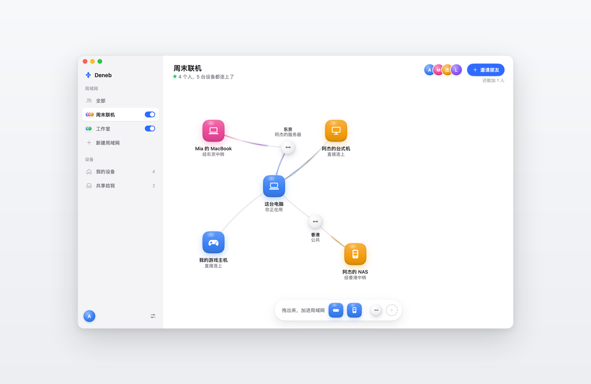
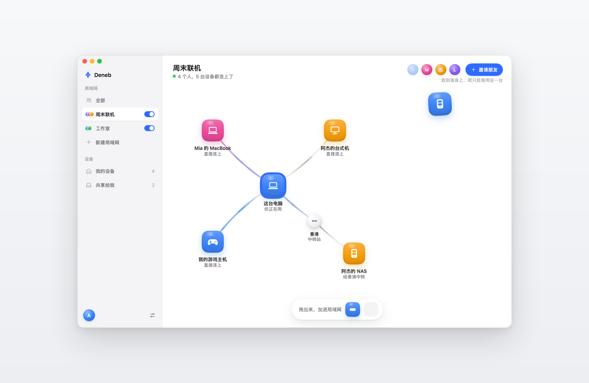
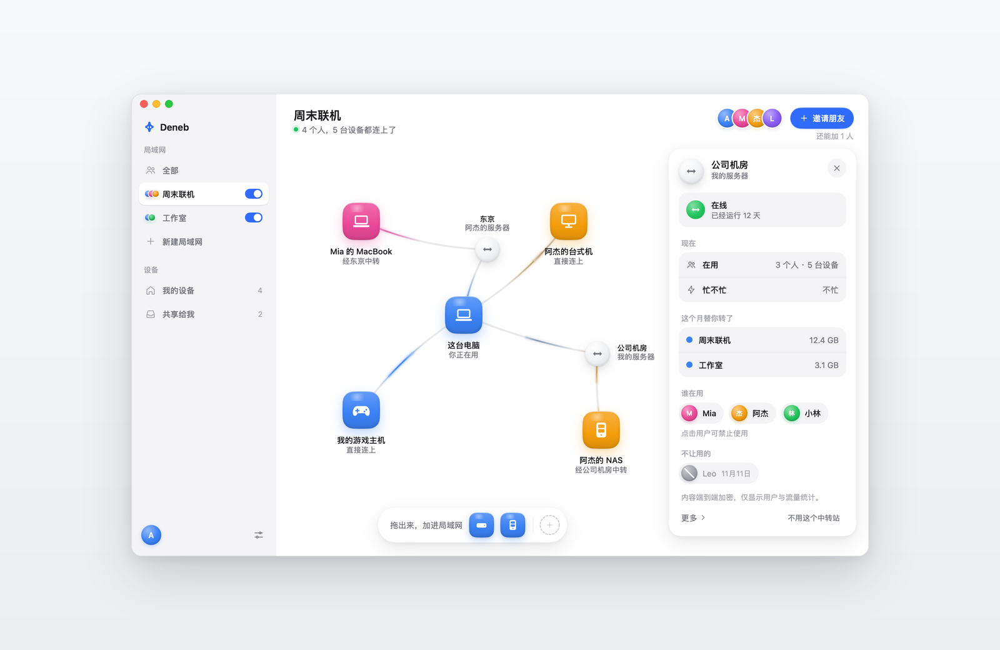
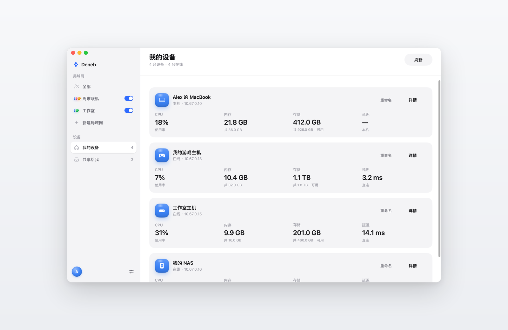
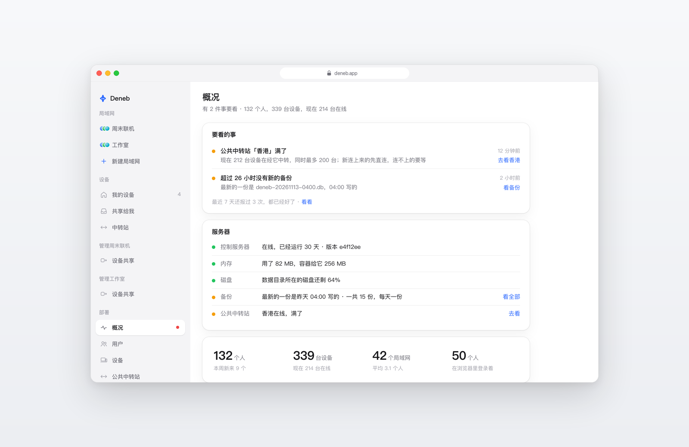

<p align="center">
  
</p>

<h1 align="center">Deneb</h1>

<p align="center">
  <strong>Put your computers, servers and your friends' devices on one private network.<br>
  Drag things where you want them. No forms, no config files.</strong>
</p>

<p align="center">
  <a href="https://github.com/kittors/deneb/releases/latest">Download</a> ·
  <a href="#how-it-works">How it works</a> ·
  <a href="#self-hosting">Self-hosting</a> ·
  <a href="#building-from-source">Build from source</a> ·
  <a href="PRIVACY.md">Privacy</a>
</p>

<p align="center">
  <a href="https://github.com/kittors/deneb/actions/workflows/ci.yml"></a>
</p>

<p align="center">
  <picture>
    <source media="(prefers-color-scheme: dark)" srcset="docs/images/lan-dark.png">
    
  </picture>
</p>

Deneb is an open-source mesh VPN for people who are not network administrators. Every device you add gets a private address and a name, and reaches the others as if they were all behind the same home router — wherever they actually are. Connections are end-to-end encrypted with WireGuard and go peer to peer whenever the network allows it.

Your network is drawn as a canvas. Devices, people and relays are things you can see, drag and click, and the app speaks in plain words: *connected directly*, *via a relay*, *waiting for your OK*.

## Highlights

- **Several LANs at once, one account.** Be in your family's LAN, your studio's and your game night's at the same time. There is no "switch account".
- **Share one device by dragging it onto a person.** They get that device and nothing else. They don't need to be an administrator, or even have a LAN of their own.
- **Services, not access rules.** A device opens Remote Desktop, a shared folder or a website to the LANs you choose; other people reach what you open, not the whole machine.
- **See how you are connected.** Every link shows whether it is direct or relayed, and why. Missing a relay? Drag one in.
- **Your own relay in one command.** Run it on any server you have; public relays are always there as a fallback.
- **Nothing waits in silence.** A device asking to join your LAN shows up on the canvas, dashed, until you let it in.
- **Plays well with others.** Addresses never come from Tailscale's `100.64.0.0/10` or Clash's `198.18.0.0/15`, so Deneb runs next to them.
- **Desktop and web.** Native apps for macOS, Windows and Linux; everything can also be managed from a browser.
- **Yours to run.** The control server, relays and web app are open source and self-hostable.

## Screenshots

<table>
  <tr>
    <td width="50%">
      <picture>
        <source media="(prefers-color-scheme: dark)" srcset="docs/images/share-dark.png">
        
      </picture>
      <br><sub><b>Share a device</b> by dragging it onto a person.</sub>
    </td>
    <td width="50%">
      <picture>
        <source media="(prefers-color-scheme: dark)" srcset="docs/images/relays-dark.png">
        
      </picture>
      <br><sub><b>Relays</b>: your own servers and the public ones, with their load.</sub>
    </td>
  </tr>
  <tr>
    <td width="50%">
      <picture>
        <source media="(prefers-color-scheme: dark)" srcset="docs/images/my-devices-dark.png">
        
      </picture>
      <br><sub><b>My devices</b>: every device you own, and how it is doing.</sub>
    </td>
    <td width="50%">
      <picture>
        <source media="(prefers-color-scheme: dark)" srcset="docs/images/web-console-dark.png">
        
      </picture>
      <br><sub><b>The web app</b>, with an operations console for the people who run a deployment.</sub>
    </td>
  </tr>
</table>

The app follows your system's light or dark appearance, and so do these screenshots.

## Download

Get the latest version from **[Releases](https://github.com/kittors/deneb/releases/latest)**:

| Platform | Package |
| --- | --- |
| macOS, Apple silicon | the `.dmg` |
| Windows, x64 | the `setup` `.exe` |
| Linux, x64 and Arm64 | the app's `.deb` and the engine's `denebd` `.deb` |
| Linux servers, no desktop | the `deneb-server` `.deb`, then `deneb login` |

On Debian or Ubuntu, install the app and its engine together:

```sh
sudo apt install ./denebd_<version>_amd64.deb ./deneb_<version>_amd64.deb
```

Good to know:

- **The interface is in Simplified Chinese** for now.
- **macOS builds are not notarized yet.** The first time you open Deneb, macOS stops it: open **System Settings → Privacy & Security**, scroll to **Security** and click **Open Anyway**.
- **The Windows installer is not code-signed yet.** If SmartScreen says *Windows protected your PC*, click **More info → Run anyway**.
- The macOS and Windows apps update themselves; on Linux, install the newer `.deb`.
- There are no phone or tablet apps yet. On a phone, use the web app.

## How it works

```text
                  ┌──────────────────────┐
                  │    deneb-control     │  accounts, LANs, invitations,
                  │   (control server)   │  device keys, network maps
                  └──────────┬───────────┘
              HTTPS, pinned  │  never sees your traffic
           ┌─────────────────┴─────────────────┐
     ┌─────┴──────┐                      ┌─────┴──────┐
     │   denebd   │   WireGuard, direct  │   denebd   │
     │  your Mac  │◄────────────────────►│  your NAS  │
     └─────┬──────┘                      └─────┬──────┘
           │        when direct fails          │
           └──────────►┌─────────────┐◄────────┘
                       │ deneb-relay │  forwards packets it cannot read
                       └─────────────┘
```

| Part | What it does |
| --- | --- |
| [`cmd/denebd`](cmd/denebd) | **The engine.** WireGuard ([wireguard-go](https://git.zx2c4.com/wireguard-go)) for the data, STUN to find a direct path through NATs, a relay when there is none. Runs as a system service with a real network interface, or in user space with a SOCKS5 proxy. It is also the `deneb` command line. |
| [`cmd/deneb`](cmd/deneb) | **The desktop app** for macOS, Windows and Linux. Its interface is drawn by Deneb itself, in Go, with [MyGo](https://github.com/egoist/mygo), so it looks the same on all three. |
| [`cmd/deneb-control`](cmd/deneb-control) | **The control server.** Sign-in by email code, LANs, invitations and seats, sharing, device keys and the network map each device gets. One process and one SQLite file; devices pin its certificate. |
| [`cmd/deneb-relay`](cmd/deneb-relay) | **The relay**, built on Tailscale's DERP and STUN servers. It asks the control server who may use it, and only forwards WireGuard packets it cannot decrypt. |
| [`cmd/deneb-web`](cmd/deneb-web), [`web/`](web) | **The web app**: LANs, devices, sharing and relays in a browser, plus an operations console for the people who run a deployment. |
| [`cmd/deneb-watchdog`](cmd/deneb-watchdog) | Watches a deployment from another machine — the control server, relays, backups, disk — and tells its operator when something is wrong. |

Each device gets one IPv4 address from a `/16` inside `10.0.0.0/8` and one IPv6 address from a private `/48`, both chosen once per deployment, and a name like `nas.jie.deneb.internal`.

## Self-hosting

A Deneb deployment is one control server, any number of relays, and optionally the web app. All of them ship as small Docker images.

| Directory | What is in it |
| --- | --- |
| [`deploy/control`](deploy/control) | The control server's image, an example seed file ([`seed.example.json`](deploy/control/seed.example.json)) for operators and test accounts, backup and restore drills. |
| [`deploy/relay`](deploy/relay) | The relay's image. In the app's relay page, *Use my own server* gives you a one-line install command instead. |
| [`deploy/web`](deploy/web) | The web app's image and an nginx site template ([`site.example.env`](deploy/web/site.example.env)). |

Sign-in codes are sent by email, so the control server needs an SMTP account. Deployment notes are in [`deploy/`](deploy) and [`design/plan/`](design/plan) (in Chinese).

## Building from source

You need Go 1.27.3 or later.

```sh
git clone https://github.com/kittors/deneb
cd deneb
go build ./...
go test -p 1 ./...    # the whole suite takes a while; -p 1 keeps memory use low
```

To build installable packages:

```sh
deploy/package.sh macos      # on a Mac: Deneb.app and a .dmg
deploy/package.sh windows    # the installer; needs NSIS (makensis)
deploy/package.sh linux      # .deb packages; needs Docker
```

The packages land in `deploy/out/<version>/`. [`deploy/release.sh`](deploy/release.sh) builds, signs and uploads a release; [`deploy/updates.md`](deploy/updates.md) describes how updates are published.

## Project status

Deneb is young and moving fast. Its author and friends use it every day; expect rough edges, and please [open an issue](https://github.com/kittors/deneb/issues) when you hit one. What changed in each version is in [CHANGELOG.md](CHANGELOG.md).

## Privacy

The control server knows your email address, your devices and your LANs — not what you send. Traffic between devices is end-to-end encrypted, and relays forward packets they cannot read. Server logs are kept for 30 days. The full privacy statement, in Chinese, is in [PRIVACY.md](PRIVACY.md).

## License

Deneb is released under the [PolyForm Noncommercial License 1.0.0](LICENSE): free for personal use, study, research and non-profit organizations, including changing it and sharing it.

**Commercial use requires the author's permission.** Please contact [kittors](https://github.com/kittors) on GitHub.

Third-party code Deneb uses, such as WireGuard and parts of Tailscale, remains under its own licenses; each package carries their notices.

## Acknowledgements

Deneb stands on [WireGuard](https://www.wireguard.com), the open-source networking code of [Tailscale](https://github.com/tailscale/tailscale), and [MyGo](https://github.com/egoist/mygo).
